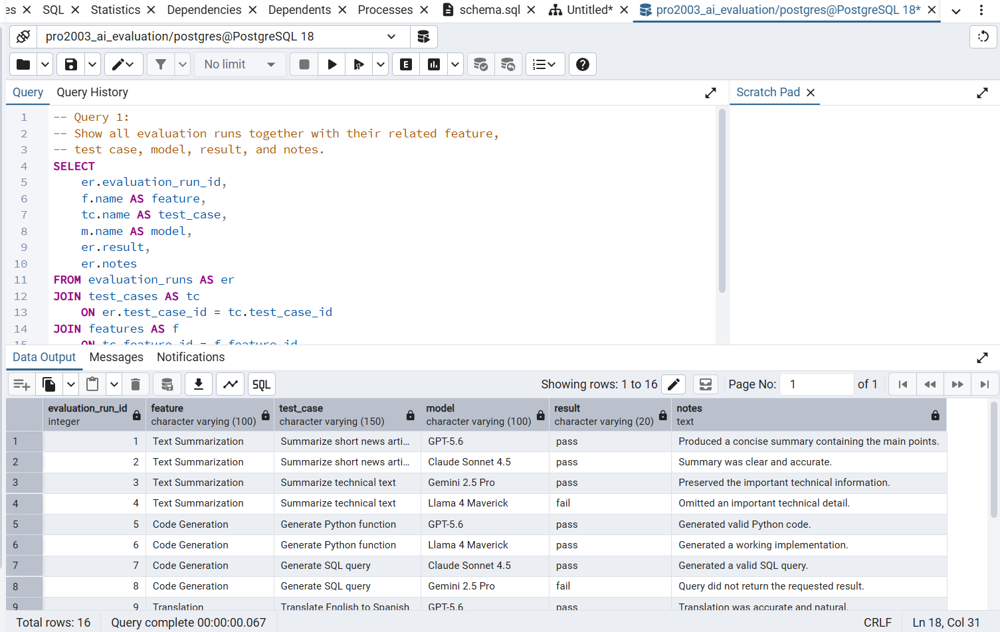
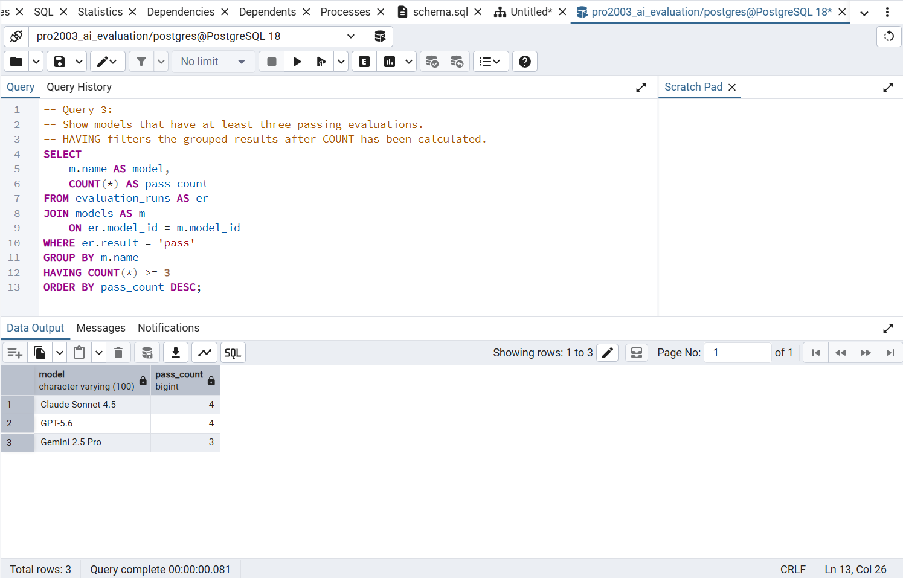
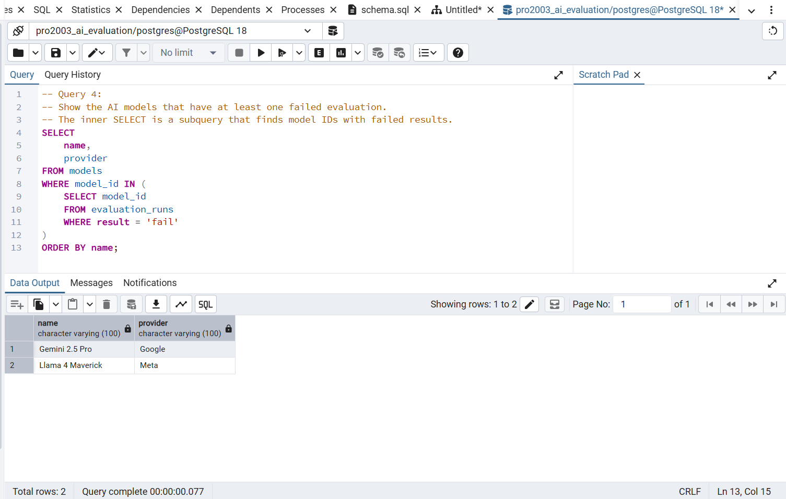
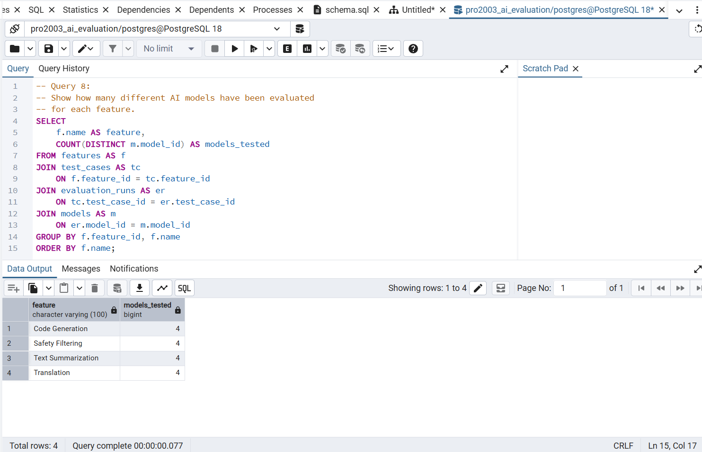
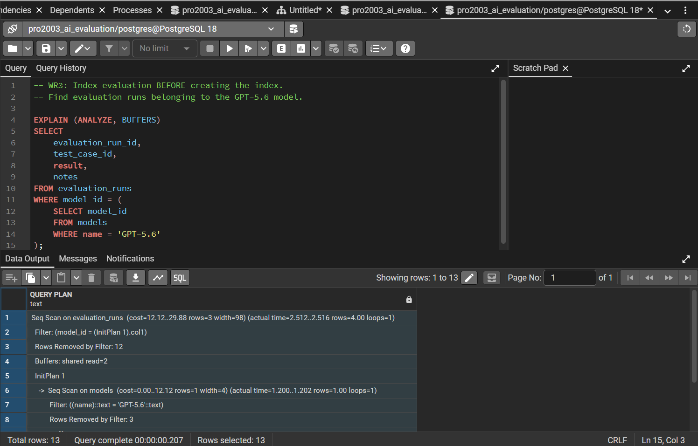
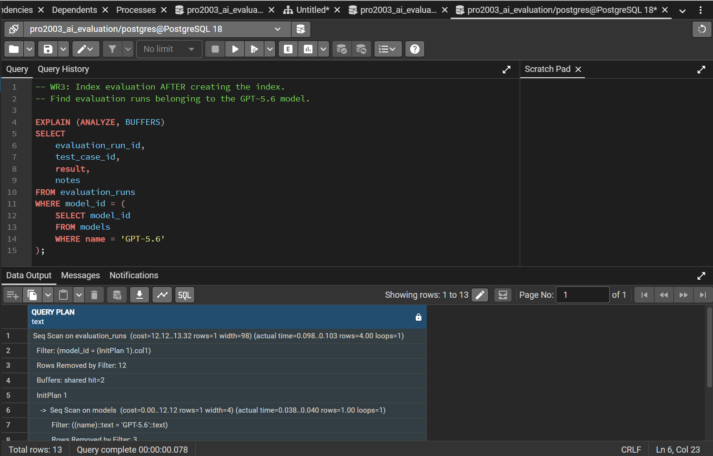
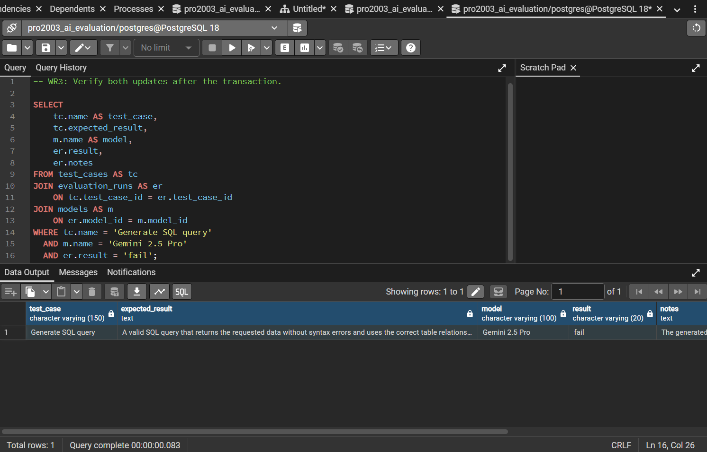
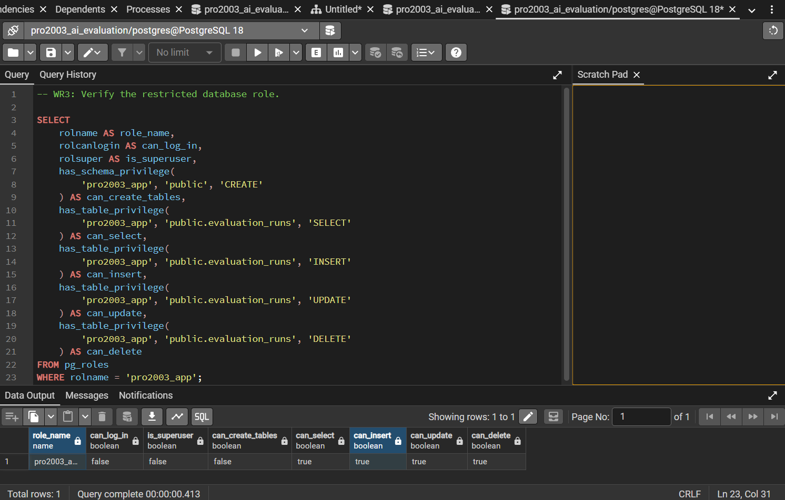
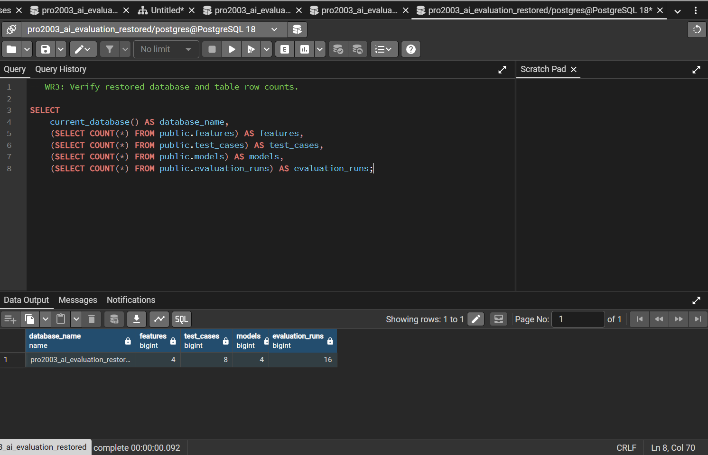

# PRO2003 Work Requirement 1
## AI Model Evaluation Database

### Domain

This project contains a small PostgreSQL database for evaluating AI models.

The database is designed to keep track of AI features, test cases, AI models, and evaluation runs. A feature can have several test cases, and each test case can be evaluated using different AI models.

### Database Design

The database contains four related tables:

- `features` – stores the AI features that are being tested.
- `test_cases` – stores individual test cases connected to a feature.
- `models` – stores the AI models used during evaluation.
- `evaluation_runs` – stores the result of running a model against a test case.

### Relationships

There is a one-to-many relationship between `features` and `test_cases`.

One feature can have many test cases, while each test case belongs to one feature.

There is also a many-to-many relationship between `test_cases` and `models`.

This relationship is resolved through the intermediate table `evaluation_runs`. Each evaluation run connects one test case with one model and stores the result of that evaluation.

### Keys and Constraints

Each table has a primary key.

Foreign keys are used to connect the tables:

- `test_cases.feature_id` references `features.feature_id`
- `evaluation_runs.test_case_id` references `test_cases.test_case_id`
- `evaluation_runs.model_id` references `models.model_id`

Required values use `NOT NULL`.

The `result` column in `evaluation_runs` uses a `CHECK` constraint so that only `pass` or `fail` can be stored.

### Files

- `schema.sql` contains the PostgreSQL DDL statements used to create the database.
- `er_model.png` contains the ER model using Crow's Foot relationships.
---

# PRO2003 Work Requirement 2

## Administer PostgreSQL Database

For Work Requirement 2, the database from Work Requirement 1 was populated with realistic test data and used to practice modifying, retrieving, combining, and analyzing relational data with SQL.

The work was completed using PostgreSQL 18 and pgAdmin 4.

## Test Data

The database was populated with data for:

- 4 AI features
- 8 test cases
- 4 AI models
- 16 evaluation runs

The test data contains different features, models, test cases, and both `pass` and `fail` evaluation results.

The file `populate_data.sql` contains the SQL statements used to populate the database.

## Data Modification

The file `modify_data.sql` demonstrates:

- `UPDATE`
- `DELETE FROM`

Before modifying or deleting data, the relevant rows were checked using `SELECT` statements.

## Queries

The file `queries.sql` contains eight documented `SELECT` queries.

The queries demonstrate:

- retrieving related data from multiple tables
- `JOIN ... ON`
- `LEFT JOIN`
- aggregate functions such as `COUNT`
- `COUNT(DISTINCT ...)`
- `GROUP BY`
- `HAVING`
- filtering with `WHERE`
- a subquery using `IN`

Each query includes SQL comments describing its purpose.

## Query Result Examples

### Query 1 – Joining related tables

This query combines evaluation runs with their related feature, test case, and AI model.



### Query 3 – GROUP BY and HAVING

This query counts passing evaluations for each model and uses `HAVING` to return models with at least three passing evaluations.



### Query 4 – Subquery

This query uses a subquery to find AI models that have at least one failed evaluation.



### Query 8 – COUNT DISTINCT

This query counts how many different AI models have been evaluated for each feature.



## Files

- `schema.sql` – creates the database tables and constraints
- `populate_data.sql` – inserts realistic test data
- `modify_data.sql` – demonstrates updating and deleting data
- `queries.sql` – contains eight documented SELECT queries
- `er_model.png` – ER model from Work Requirement 1
- `screenshots/` – screenshots showing selected query results
# PRO2003 Work Requirement 3

## Improve and Protect Your PostgreSQL Database

### 1. Database Normalization – Third Normal Form (3NF)

The existing AI Model Evaluation Database was reviewed to determine whether its structure follows Third Normal Form (3NF).

The database contains four related tables: `features`, `test_cases`, `models`, and `evaluation_runs`.

**First Normal Form (1NF):** Each table has a primary key, and the columns store individual values rather than repeating groups.

**Second Normal Form (2NF):** All four tables use single-column primary keys. Non-key attributes therefore do not have partial dependencies on these primary keys.

**Third Normal Form (3NF):** Based on the intended relationships and functional dependencies, the non-key attributes describe their respective entities without problematic transitive dependencies.

- `features` stores information about individual AI features.
- `test_cases` stores test cases and references their associated features through a foreign key.
- `models` stores AI model information.
- `evaluation_runs` connects test cases and models while storing the outcome of each evaluation.

Separating these entities reduces unnecessary data duplication and helps maintain data consistency.

**Conclusion:** Based on the current database design and its intended functional dependencies, the database satisfies 3NF. No structural changes are necessary at this stage.
### 2. Indexing and Query Performance

An index was created on `evaluation_runs.model_id` to evaluate whether it could improve queries filtering evaluation runs by AI model.

The query was evaluated using `EXPLAIN (ANALYZE, BUFFERS)` before and after creating the index.

**Index:**

```sql
CREATE INDEX IF NOT EXISTS idx_evaluation_runs_model_id
ON evaluation_runs (model_id);
```

**Query Plan Comparison**

| Measurement | Before Index | After Index |
|---|---|---|
| Scan Method | Seq Scan | Seq Scan |
| Rows Returned | 4 | 4 |
| Rows Removed by Filter | 12 | 12 |
| Planning Time | 7.861 ms | 3.181 ms |
| Execution Time | 2.574 ms | 0.168 ms |
| Index Used | No | No |

**Evaluation:**

PostgreSQL used a sequential scan both before and after the index was created.

The `evaluation_runs` table contains only 16 rows, so scanning the entire table may be more efficient than using an index.

Although execution time was lower in the second measurement, the query plan did not use the new index. The difference may have been influenced by caching and disk access rather than the index itself.

**Conclusion:** The index was successfully created and evaluated, but no performance improvement attributable to the index was demonstrated. It may become more useful as the database grows.

The SQL script is available in `index.sql`.

**Before Index:**



**After Index:**



### 3. Transactions

A PostgreSQL transaction was implemented to demonstrate how multiple related database changes can be performed as one atomic operation.

**Scenario:**

The expected result for the `Generate SQL query` test case was updated together with the evaluation notes for the `Gemini 2.5 Pro` model.

Both changes belong to the same evaluation review and should be saved together.

**Implementation:**

The transaction is defined in `transaction.sql` and contains:

- `BEGIN` to start the transaction.
- Two `UPDATE` statements modifying related records.
- `COMMIT` to save both changes.

If an error occurs before the transaction is committed, the transaction can be rolled back to prevent partial changes.

**Verification:**

The transaction executed successfully in pgAdmin.

A follow-up SELECT query confirmed that both `expected_result` and `notes` contained their updated values.

**Conclusion:**

The transaction demonstrated atomic execution of multiple related SQL statements while maintaining consistency between the test case and its evaluation.

**Transaction verification screenshot:**



### 4. Database Roles and Permissions

A restricted PostgreSQL role named `pro2003_app` was created to demonstrate database access control and the principle of least privilege.

**Purpose:**

The role provides permissions for application-level CRUD operations without granting database administrator privileges.

**Implementation:**

The SQL script `roles_permissions.sql` creates the role using `NOLOGIN` and grants the following permissions:

- `CONNECT` on the project database.
- `USAGE` on the `public` schema.
- `SELECT`, `INSERT`, `UPDATE`, and `DELETE` on existing tables.
- `USAGE` and `SELECT` on existing sequences to support inserts using SERIAL columns.

The role cannot log in directly and does not have superuser privileges or permission to create tables in the `public` schema.

**Verification:**

PostgreSQL privilege functions were used to verify the role's permissions.

The results confirmed:

- Login permission: false
- Superuser: false
- CREATE permission on the public schema: false
- SELECT, INSERT, UPDATE, DELETE: true

A practical test was also performed using `SET LOCAL ROLE pro2003_app` inside a transaction.

The test confirmed that the role could read all 16 records from `evaluation_runs` and did not have CREATE permission on the public schema.

The test ended with `ROLLBACK`, restoring the original role without modifying database data.

**Conclusion:**

The restricted role was successfully created and verified. It provides the permissions needed for application-level data operations while limiting administrative access.

**Permissions verification screenshot:**



### 5. Database Backup and Restore

A full backup of the PostgreSQL database was created and successfully restored into a separate database using pgAdmin 4.

**Purpose:**

The goal was to demonstrate how a PostgreSQL database can be backed up and recovered without overwriting the original database.

**Backup Procedure:**

1. Open pgAdmin 4 and connect to PostgreSQL 18.
2. Right-click the original database `pro2003_ai_evaluation`.
3. Select `Backup`.
4. Choose `Custom` as the backup format.
5. Save the backup as `pro2003_ai_evaluation_wr3.backup`.
6. Keep the remaining options at their default values and run the backup.

Result: `Successfully completed`.

**Restore Procedure:**

1. Create a new empty database named `pro2003_ai_evaluation_restored`, owned by `postgres`.
2. Right-click the new database and select `Restore`.
3. Select the previously created Custom-format backup file.
4. Keep the default restore settings without enabling `Clean before restore`.
5. Run the restore operation.

Result: `Successfully completed`.

**Verification:**

The following SQL query was executed against the restored database:

```sql
SELECT
    current_database() AS database_name,
    (SELECT COUNT(*) FROM public.features) AS features,
    (SELECT COUNT(*) FROM public.test_cases) AS test_cases,
    (SELECT COUNT(*) FROM public.models) AS models,
    (SELECT COUNT(*) FROM public.evaluation_runs) AS evaluation_runs;
```

The restored database returned:

| Table | Restored Rows |
|---|---:|
| features | 4 |
| test_cases | 8 |
| models | 4 |
| evaluation_runs | 16 |

All four tables were present and contained the expected number of records.

**Conclusion:**

The backup and restore procedures completed successfully. The restored database was verified separately, while the original database was preserved.

The backup file is stored locally and is not included in the GitHub repository.

**Restore verification screenshot:**


